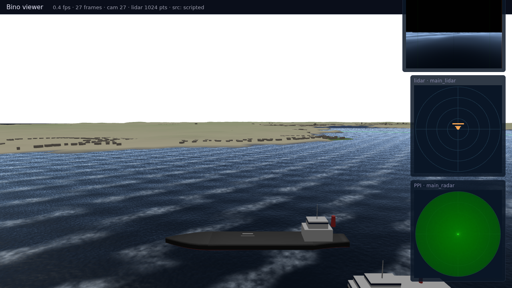
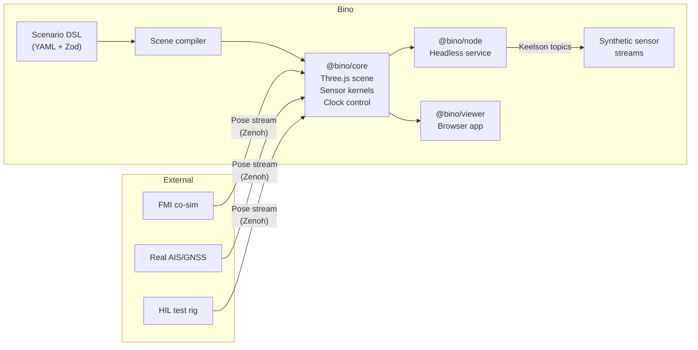

# Bino

_A maritime perception sensor emulator for verification & validation_

---



Bino is a 3D world renderer and synthetic perception sensor emulator
for maritime applications. It produces real-time **camera**, **lidar**,
and **marine radar** data from injected pose streams — driving a
simulated world from external sources (FMI co-simulation, real-world
feeds, scripted scenarios) rather than computing dynamics itself.

## Key features

- **Three sensor types** — camera (WebGL render-to-texture), lidar
  (BVH ray-cast in Rust/WASM), marine radar (K-distribution sea
  clutter, Gaussian antenna pattern, ITU-R P.838 rain attenuation)
- **Three V&V modes** — replace (fully synthetic), inject (synthetic
  objects in real sensor stream), inject-all (HIL/SIL with external
  clock)
- **One codebase, two environments** — the same TypeScript modules run
  in a headless Node service (for production V&V) and a browser viewer
  (for demos and debugging)
- **YAML scenario DSL** — declarative scene definitions validated by
  Zod schemas at compile time
- **Keelson/Zenoh integration** — sensor output published on topics
  that mirror real sensor interfaces; consumers swap synthetic for real
  without code changes
- **Deterministic mode** — frame-index-driven clock and seeded PRNG
  for bit-for-bit reproducible V&V runs
- **Real-world terrain** — OSM coastline, GMRT bathymetry, building
  footprints, seamarks, Gerstner wave synthesis
- **Performance escape hatches** — Rust/WASM kernels for lidar and
  radar; TypeScript everywhere else

## Quick start

```bash
pnpm install && pnpm build

# Browser viewer (standalone, no external infrastructure)
pnpm -C packages/viewer dev          # http://localhost:5173

# Headless service
node packages/node/dist/cli.js scenarios/v04_kiel.yaml
```

See the [tutorial](docs/tutorial.md) for a full walkthrough including
Zenoh integration and scenario authoring.

## Container images

Two images are built from one multi-stage `Dockerfile` (the Rust→WASM
kernels are compiled inside the build, so no local toolchain is needed):

```bash
# Headless service — software GL (Xvfb + bundled SwiftShader), runs anywhere
docker build --target node -t bino-node .
docker run --rm -v "$PWD/scenarios:/scenarios" bino-node \
  /scenarios/v04_kiel.yaml --zenoh ws://host:7447

# Browser viewer — static site served by nginx (renders client-side)
docker build --target viewer -t bino-viewer .
docker run --rm -p 8080:80 bino-viewer        # http://localhost:8080
```

- Mount a volume at `/cache` (or set `BINO_TERRAIN_CACHE`) to persist or
  pre-seed fetched terrain for offline runs. Run `pnpm prefetch:scenarios`
  (after `pnpm build`) to warm that cache for every scenario up front, so the
  first container run starts fast and offline.
- For the browser viewer, `pnpm viewer:prefetch` writes static terrain bundles
  into `packages/viewer/static/terrain/` (gitignored). The viewer reads a
  bundle on first load (then caches it in IndexedDB), so a cold visit doesn't
  hit the public OSM/GMRT APIs. A missing bundle simply falls back to the
  network. Enable gzip on the static host — bundles are large JSON.
- A GPU-accelerated node variant is deferred; the camera render is the only
  GPU-bound path, and software GL is more reproducible for deterministic runs.

Tagged releases publish both images to GHCR via the `release-images` workflow.

## Architecture



Three packages share a single rendering core:

| Package          | Role                                                                       |
| ---------------- | -------------------------------------------------------------------------- |
| **@bino/core**   | Pure TypeScript library — DSL, scene compiler, sensor kernels, geo helpers |
| **@bino/node**   | Headless Node service in Docker — subscribes poses, publishes sensor data  |
| **@bino/viewer** | SvelteKit browser app — same scene, same kernels, live preview             |

Rust/WASM sensor kernels live in `kernels/` (radar + lidar), compiled
to both native crates and WASM modules.

## Sensor models

| Sensor           | Approach                             | Key references                                                        |
| ---------------- | ------------------------------------ | --------------------------------------------------------------------- |
| **Camera**       | WebGL render-to-texture              | --                                                                    |
| **Lidar**        | BVH ray-cast (Rust/WASM)             | Moller-Trumbore, median-split AABB tree                               |
| **Marine radar** | Geometry-of-returns + physics layers | Ward 1981 (K-distribution), Nathanson (sigma-0), ITU-R P.838-3 (rain) |

Detailed theory and equations in [docs/sensor-models/](docs/sensor-models/).

## Documentation

| Document                                         | Description                                                    |
| ------------------------------------------------ | -------------------------------------------------------------- |
| [Tutorial](docs/tutorial.md)                     | Quick-start walkthrough — clone to sensor output in 10 minutes |
| [User guide](docs/user-guide.md)                 | Full operational reference — CLI, Docker, Zenoh, modes         |
| [DSL reference](docs/dsl-reference.md)           | Complete scenario YAML field reference                         |
| [Architecture](docs/architecture.md)             | Package structure, data flow, build system, testing            |
| [Radar model](docs/sensor-models/radar.md)       | K-distribution clutter, antenna pattern, rain attenuation      |
| [Lidar model](docs/sensor-models/lidar.md)       | BVH ray-cast, two-tree design, temporal interpolation          |
| [Camera model](docs/sensor-models/camera.md)     | WebGL pipeline, exposure model                                 |
| [Environment](docs/sensor-models/environment.md) | Sea surface, terrain sources, sky, geo-registration            |

## Project structure

```
bino/
├── packages/
│   ├── core/          @bino/core — DSL, scene, kernels (pure TS)
│   ├── node/          @bino/node — headless service, Docker
│   └── viewer/        @bino/viewer — SvelteKit browser app
├── kernels/
│   ├── radar/         Rust marine radar kernel
│   └── lidar/         Rust BVH ray-cast kernel
├── scenarios/         YAML scenario files + templates
├── docs/              Documentation suite
└── tests/             Integration test infrastructure
```
