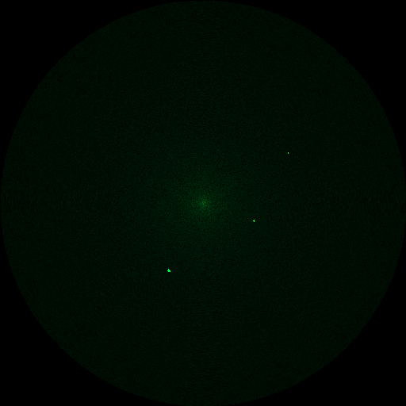
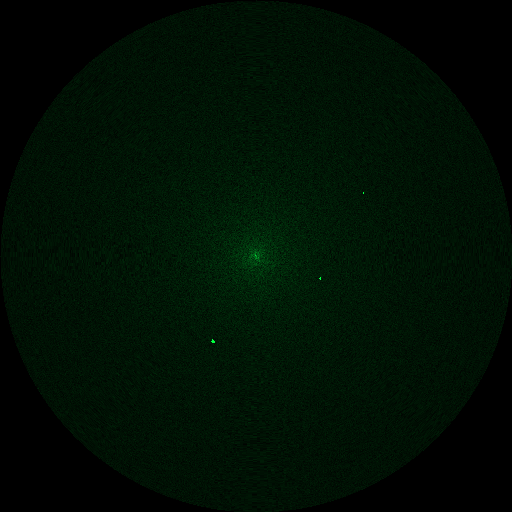
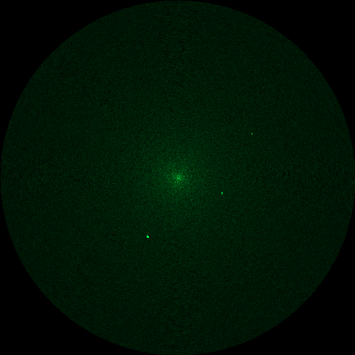

# Marine Radar Sensor Model

## Overview

Bino's marine radar emulator produces plan-position indicator (PPI) imagery for
X-band (9.4 GHz default) navigational radar. The model is layered:

1. **Geometry-of-returns** -- ray-AABB intersection for vessel echoes.
2. **K-distribution sea clutter** -- Ward (1981) compound model driven by significant wave height.
3. **Gaussian antenna pattern** -- azimuthal convolution with a user-specified beam width.
4. **ITU-R P.838-3 rain attenuation** -- power-law specific attenuation applied as two-way path loss.

Each layer can be independently enabled. With all layers disabled, output is
binary (v0.3 backward compatibility).

## Geometry-of-returns

Each vessel is represented as an axis-aligned bounding box (AABB) in the
horizontal plane. A single 2-D ray is cast per spoke per vessel.

**Azimuth sweep.** The antenna rotates through `spokes_per_rev` uniformly spaced
azimuths over a full revolution:

```
azimuth_i = (i / spokes_per_rev) * 2 * pi       i = 0, 1, ..., spokes_per_rev - 1
```

**Range discretization.** Each spoke is quantized into `range_bins` bins. The
center of bin `j` is:

```
r_j = (j + 0.5) * range_m / range_bins
```

**Vessel return.** A ray-box hit places a fixed-intensity return
(`VESSEL_INTENSITY = 1.0`) in the nearest range bin. When multiple vessels are
hit, the closest intersection is used. Vessel returns are composited with
clutter via `max(vessel_return, clutter + noise)`.

## Sea clutter (K-distribution)

The sea clutter amplitude at each range bin follows the K-distribution compound
model (Ward 1981). The amplitude is:

```
amplitude = sqrt(texture * speckle * sigma_0)
```

where:

- `texture ~ Gamma(nu, 1/nu)` -- slow-varying component representing bunching of
  scatterers on the sea surface.
- `speckle ~ Exponential(1)` -- fast Rayleigh-envelope speckle from random
  scatterer phases.
- `sigma_0` -- mean normalized radar cross-section per unit area (linear scale).

### Mean cross-section model

A Nathanson-inspired empirical fit for X-band, HH polarization:

```
sigma_0(dB) = -40 + 10 * log10(Hs) + 15 * log10(sin(psi))
sigma_0(linear) = 10^(sigma_0(dB) / 10)
```

where `Hs` is significant wave height (m) and `psi` is the grazing angle (rad).

### Shape parameter

```
nu = clamp(30 / (Hs + 0.5), 1.0, 100.0)
```

Lower `nu` produces spikier, more impulsive returns characteristic of rougher
seas. Over the operational range Hs in [0, 6] m, `nu` spans approximately [5, 60].

### Grazing angle (flat-earth)

```
psi = atan(h / r)
```

where `h` is the radar antenna height above the sea surface and `r` is the
slant range to the bin center.

### Thermal noise floor

An additive Rayleigh-distributed noise term models receiver thermal noise:

```
noise = sqrt(Exponential(1) * NOISE_FLOOR)
```

with `NOISE_FLOOR = 1e-8`.

### Per-bin composition

```
intensity = max(vessel_return, clutter + noise)
```

The vessel return (when present) always dominates clutter because
`VESSEL_INTENSITY = 1.0` is far above typical clutter amplitudes.

### Effect of sea state

|          Calm (Hs = 0.3 m)          |            Moderate (Hs = 2.0 m)            |          Rough (Hs = 5.0 m)           |
| :---------------------------------: | :-----------------------------------------: | :-----------------------------------: |
|  |  |  |

## Antenna pattern convolution

The antenna main lobe is modeled as a Gaussian with full-width at half-maximum
(FWHM) equal to `beam_width_deg` from the scenario DSL.

**Standard deviation:**

```
sigma_deg = beam_width_deg / 2.355
```

**One-way voltage beam gain:**

```
G(offset_deg) = exp(-0.5 * (offset_deg / sigma_deg)^2)
```

Convolution is performed as a 1-D FIR filter across the azimuth dimension, per
range bin. The kernel radius is +/-2 sigma spokes (capturing approximately 95% of
the beam energy). Weights are normalized to sum to 1.0, making the filter
energy-conserving. The convolution wraps circularly around the full 360-degree
sweep.

## Rain attenuation (ITU-R P.838-3)

Rain causes range-dependent signal loss via absorption and scattering. The
specific attenuation follows the ITU-R P.838-3 power-law model:

```
alpha = k * R^a       (dB/km)
```

where `R` is the rain rate in mm/h. Coefficients `k` and `a` depend on
frequency and polarization.

**Coefficient interpolation.** The implementation stores the following ITU-R
P.838-3 Table 1 entries for horizontal polarization:

| Freq (GHz) |    k_H    |  a_H  |
| :--------: | :-------: | :---: |
|    1.0     | 0.0000387 | 0.912 |
|    3.0     | 0.000650  | 1.121 |
|    6.0     |  0.00175  | 1.308 |
|    10.0    |  0.0101   | 1.276 |
|    15.0    |  0.0367   | 1.154 |
|    20.0    |  0.0751   | 1.099 |
|    30.0    |   0.187   | 1.021 |
|    50.0    |   0.536   | 0.873 |

Between table entries, `k` is log-interpolated (it spans several orders of
magnitude) and `a` is linearly interpolated. At the default X-band frequency of
9.4 GHz, the interpolated values are k_H ~ 0.0101, a_H ~ 1.276.

**Two-way path loss per range bin:**

```
factor = 10^(-2 * alpha * r_km / 10)
```

This factor is applied multiplicatively to each bin's intensity after clutter
generation and antenna convolution.

## Determinism

All stochastic processes (clutter texture, speckle, noise) are driven by a
built-in xoshiro128+ PRNG seeded deterministically from the sweep index:

```
seed = sweep_index XOR 0xB190_CADA_5EED_0001
```

The same `sweep_index` produces bit-identical output across runs and platforms
(given identical IEEE 754 arithmetic). No external random state is used.

## Temporal interpolation

When `sweep_duration_s > 0`, the model accounts for vessel motion during the
antenna revolution. Each spoke is assigned a time offset:

```
dt = (spoke_index / spokes_per_rev) * sweep_duration_s
```

Vessel state is linearly extrapolated to that time:

```
position_interp = position + velocity * dt
heading_interp  = heading + angular_velocity_y * dt
```

This produces motion smear and range migration effects consistent with a
mechanically rotating antenna.

## Output format

**With clutter/antenna enabled:** Continuous intensity in the range 0--255.
Clutter amplitudes are auto-scaled to 0--200 via per-sweep max normalization.
Vessel returns are pinned at 255.

**Without clutter/antenna:** Binary 0/255 output, preserving v0.3 backward
compatibility.

Each spoke carries:

- `azimuth` -- spoke bearing in radians, **vessel-relative**: **0 = bow**
  (the vessel body forward, local **+X** — how the hull models and mounts are
  authored), increasing **clockwise**, one full revolution (`0 … 2π`) per
  sweep. A target straight off the bow reads azimuth 0 regardless of vessel
  heading. (Note: this is the vessel-body forward, +X — distinct from the
  lidar/camera _sensor-local_ −Z look axis.)
- `intensity` -- vector of `u8` values, one per range bin, uniform from `0` to
  `range_m`.
- `timestamp` -- seconds elapsed from sweep start (0.0 when `sweep_duration_s` is not set).

The sweep is published as a `RadarSweep` message containing a vector of
`RadarSpoke` records.

## Known limitations

- No Doppler processing.
- No sidelobe modeling (Gaussian main lobe only).
- No temporal correlation of texture across sweeps (each sweep's K-distribution draws are i.i.d.).
- No terrain/land clutter.
- Nathanson sigma-0 approximation; proper GIT (Georgia Institute of Technology) tables are the canonical replacement for high-fidelity work.
- No Pierson-Moskowitz spectral sampling for Gerstner wave components.
- No snow, hail, or fog attenuation models.
- Flat-earth grazing angle (no wave-crest masking or shadowing effects).

## References

1. Ward, K.D. (1981). "Compound representation of high resolution sea clutter." _Electronics Letters_, 17(16), 561--563.
2. Nathanson, F.E. (1991). _Radar Design Principles_, 2nd ed. McGraw-Hill. Table 7-2.
3. ITU-R P.838-3 (2005). "Specific attenuation model for rain for use in prediction methods." International Telecommunication Union.
4. Haykin, S. & Bakker, R. (1991). "Representation of nonstationary sea clutter." Chapter in _Handbook of Statistics_, Vol. 10.
